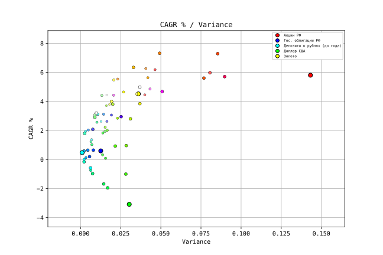
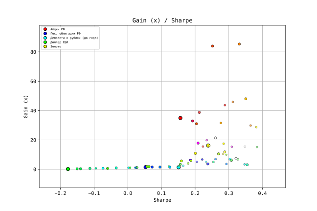

[](https://github.com/worldemar/investment-portfolio-optimizer/actions/workflows/linter.yml)
[](https://github.com/worldemar/investment-portfolio-optimizer/actions/workflows/codeql.yml)
[](https://github.com/worldemar/investment-portfolio-optimizer/actions/workflows/coverage.yml)

### Investment portfolio optimizer

This simple script will simulate rebalancing portfolios with given set of assets and display statistics.

### How to use

- Install requirements via `python3 -m pip install -r requirements.txt`

- Save market data into [config_returns.csv](config_returns.csv) file. Each row is one rebalancing period, each column is revenue from corresponding asset. Look at example file for details.
- Open [config_colors.json](config_colors.json) and edit asset colors to your taste. Colors are defined by floating-point RGB values in range [0, 1].
- Open [config_portfolios.json](config_portfolios.json) and add portfolios that you'd like to plot at all times, they will be marked with an `X` on plots.
- Run `optimizer.py` with parameters:
  - `--precision=10` - Precision is specified in percent. Asset allocation will be stepped according to this value, i.e. each asset will be allocated by multiple of 10%.
  - `--hull=1` - Use ConvexHull algorithm to select only edge-case portfolios. This considerably speeds up plotting.
    In most cases edge portfolios are most interesting anyway. `1` is the fastest, but does not plot too deep into portfolio cloud.
    If cloud edge is not very well resolved, try higher values. More portfolios will be plotted at the cost of plotting speed.
    Values higher than `3` are not very useful.
  - `--edge=2` - Use number of assets to select edge-case portfolios. `1` will plot only pure portfolios, i.e. havnig only 1 asset. `2` will plot portfolios having up to 2 assets and so on.
    Values higher than `3` are not very useful.
  - `--years=...` - specify year selection algorithm:
    - `first-to-last` - simulate single investment from first to last year in data
    - `first-to-all` - average of investments from starting year to all later years
    - `window-3` - average of all possible 3-year-long investment ranges
    - `window-5` - average of all possible 5-year-long investment ranges
    - `window-10` - average of all possible 10-year-long investment ranges
    - `window-20` - average of all possible 20-year-long investment ranges
    - `all-to-last` - average of investments from all years to last year
    - `all-to-all` - average of all possible investment ranges regardless of length
  - `--min` - Plot theoretical portfolio that allocates only one asset with worst GAGR every year
  - `--max` - Plot theoretical portfolio that allocates only one asset with best GAGR every year

Check PNG and SVG graphs in `result` folder for all portfolios performances.

### What does it actually do?

Script will generate all possible investment portfolios with every asset allocated from 0 to 100% stepping according to `--precision` parameter.

Then every portfolio is simulated through market history, rebalancing at every step. Rebalancing assumes selling all assets with new prices and buying them back according to portfolio's asset allocation. For example:

| Asset1  | Asset2  | Asset1 (20%)           | Asset2 (80%)           | Portfolio value            |
| ------- | ------- | ---------------------- | ---------------------- | -------------------------- |
| (start) | (start) | 0.2                    | 0.8                    | 1                          |
| -10%    |  25%    | 0.2 - 10% = 0.18       | 0.8 + 25% = 1          | 0.18 + 1 = 1.18            |
|         |         | 1.18 * 20% = 0.236     | 1.18 * 80% = 0.944     | 1.18 = 0.236 + 0.944       |
|  15%    |  -5%    | 0.236 + 15% = 0.2714   | 0.944 - 5% = 0.8968    | 0.2714 + 0.8968 = 1.1682   |
|         |         | 1.1682 * 20% = 0.23364 | 1.1682 * 80% = 0.93456 | 1.1682 = 0.23364 + 0.93456 |

If `--hull` is specified and is not zero, script will use ConvexHull algorithm to select only edge-case portfolios. Edge cases are calculated separately for each plot.
If `--edge` is specified and is not zero, script will filter portfolios by number of assets, plotting only those that have specified number of them or less.

### Metrics

Every simulated portfolio gets scored with these values. They are used as graph axes
and are all listed in the tooltip of every plotted point.

Given the portfolio's value multiplier for every year of an investment range:

| Metric | Meaning |
| ------ | ------- |
| `Gain(x)` | Final portfolio value after the whole range, starting from `1`. `2.5` means the capital grew 2.5x. |
| `CAGR(%)` | Compound annual growth rate: constant yearly return that would produce the same `Gain`. |
| `Pop(%)` | Largest single-year gain in the range. `0` if every year was flat or negative. |
| `Dip(%)` | Largest single-year loss in the range (negative). `0` if no year was negative. |
| `Variance` | Sample variance of yearly returns around `CAGR`. |
| `Stddev` | Square root of `Variance` - the classic volatility number. |
| `Sharpe` | `CAGR / Stddev`. Return per unit of volatility. No risk-free rate is subtracted, so treat it as a relative ranking between portfolios, not an absolute quality score. |
| `Ulcer(%)` | Ulcer index: root-mean-square drawdown of the portfolio value from its own running peak over the range. See below. |

`Stddev` (and therefore `Sharpe` and `Variance`) treats an upswing exactly like a crash,
because a square does not care about the sign. `Dip` only sees the single worst year and
does not care whether the portfolio recovered in the next year or stayed at the bottom
for years. `Ulcer` is designed to fill that gap - it measures how deep **and** how long
the portfolio stayed under its previous peak:

```
Ulcer = sqrt( mean( Di^2 ) )         Di = value(i) / max(value(0)..value(i)) - 1
```

`value(0)` is the initial investment, so falling below the entry price counts as a
drawdown too. A sharp V-shaped crash that fully recovers gets a small `Ulcer`; a slow
grinding decline that ends at the same place gets a much larger one. `Ulcer` is expressed
in percent, like `Dip`.

Dividing `CAGR(%)` by `Ulcer(%)` gives a Sharpe-like ranking that penalizes actual pain
instead of symmetric volatility; on the `CAGR vs Ulcer` and `Sharpe vs Ulcer` graphs the
best portfolios are the ones closest to the top-left corner.

### Notes on averaging

Some graphs display `Pop`, `Dip` and `Ulcer` values for portfolios, meaning largest
yearly gain, largest yearly loss and average drawdown pain.
Since year selection algorithm could select more than one year, these values are averaged among all investment periods.
For example, consider two 3-year investment periods for asset within 4-year market data:
| Year | Asset1 | 3y-period 1 | 3y-period 2 |
| ---- | ------ | ----------- | ----------- |
| 2000 |  -10%  | ✅ | |
| 2001 | 10%    | ✅ | ✅ |
| 2002 | 10%    | ✅ | ✅ |
| 2003 | -5%    | | ✅ |

Two periods have largest dip of `-10%` and `-5%` respectively. If there were no dips (all gains are positive), largest dip is considered equal to `0%`.
|             | 3y-period 1 | 3y-period 2 |
| ----------- | ----------- | ----------- |
| Largest Dip | -10%        | -5%         |

Since there are two periods, **average largest dip** is `(-10% + -5%)/2 = -7.5%`
That is not the same as `10%` which is the largest dip overall, but expected largest dip in a random 3-year period within this year range.

### Demo SVGs

You need to download these SVGs to enable interactivity. Generated using `--precision=5 --hull=1 --edge=2`.



